# Real Bengal Sweets — Application Flows

Companion to [PLAN.md](PLAN.md). Change history is in [CHANGE.md](CHANGE.md). Diagrams use Mermaid. They render on GitHub, and in VS Code with the *Markdown Preview Mermaid Support* extension.

**Contents**
1. [Site map](#1-site-map)
2. [Shopper journey](#2-shopper-journey)
3. [Add to cart and delivery-zone check](#3-add-to-cart--delivery-zone-check)
4. [Checkout and payment](#4-checkout--payment)
5. [Order lifecycle](#5-order-lifecycle)
6. [Corporate and bulk gifting enquiry](#6-corporate--bulk-gifting-enquiry)
7. [Page rendering (how customization reaches the screen)](#7-page-rendering-how-customization-reaches-the-screen)
8. [Admin: editing content and theme](#8-admin-editing-content--theme)
9. [Authentication](#9-authentication)
10. [Build-your-own box](#10-build-your-own-box)

---

## 1. Site Map

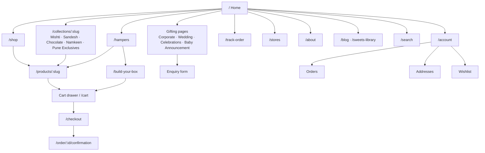

---

## 2. Shopper Journey

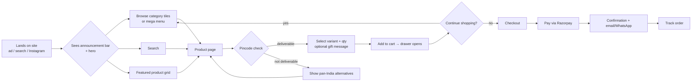

---

## 3. Add to Cart and Delivery-Zone Check

Perishable items such as rosogolla in syrup and mishti doi can only be sold in the local zone (**Pune**, including Pimpri-Chinchwad), the same way the reference site has "Mumbai only" items.

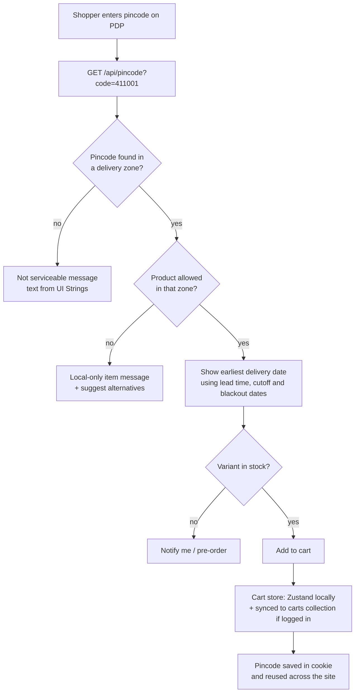

---

## 4. Checkout and Payment

The server always recalculates prices. The Razorpay **webhook** is the source of truth for whether an order is paid.

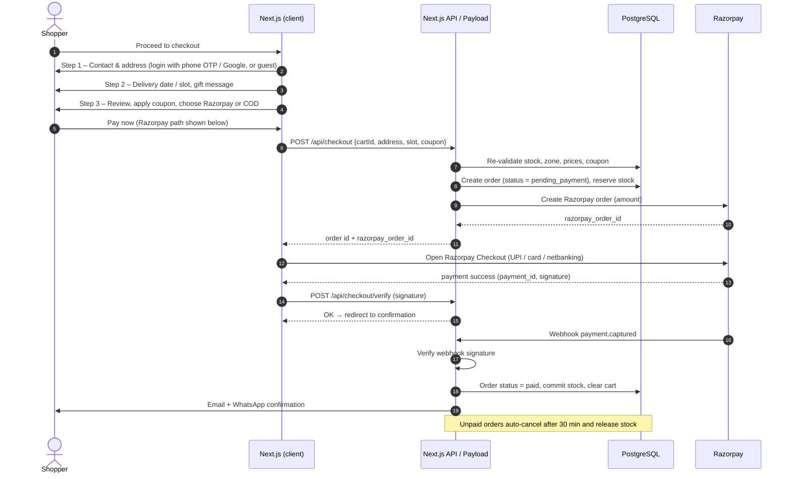

**COD path** (enabled by default): skip Razorpay, send an OTP to the shopper's phone, and on success set status = `confirmed_cod`. COD is hidden if the order is above the admin-set COD limit or the zone disallows it.

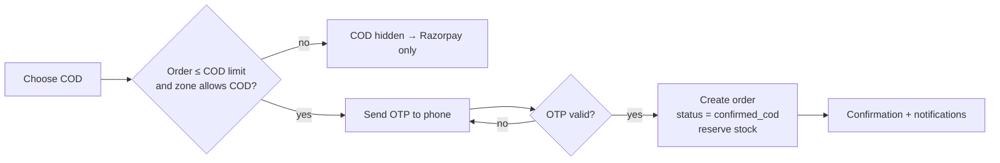

**Running locally:**
- **Without Razorpay keys**, a labelled **test-payment simulator** replaces the Razorpay window. You can choose a successful or a failed payment.
- **With test keys** (`rzp_test_…` in `.env`), the real Razorpay window opens. The `verifyRazorpayAction` server action marks the order paid after checking the signature, so no public webhook URL is needed.
- To test the real webhook (`/api/razorpay/webhook`), expose it with a tunnel such as ngrok.
- OTPs, emails and SMS are printed to the terminal running `npm run dev`. The OTP is also shown on screen.

---

## 5. Order Lifecycle

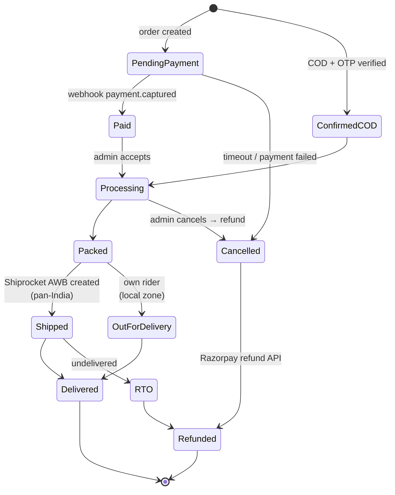

Each transition is written to `order.statusHistory`, fires the matching email/WhatsApp template, and is shown on `/track-order`.

---

## 6. Corporate and Bulk Gifting Enquiry

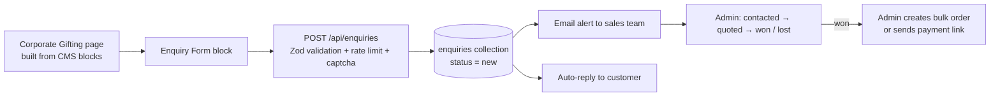

---

## 7. Page Rendering (How Customization Reaches the Screen)

This is the core of the "fully customizable" requirement. Every visible piece comes from CMS data.

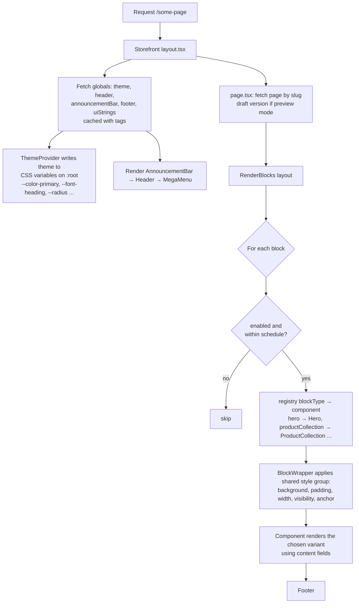

```tsx
// src/blocks/RenderBlocks.tsx (shape)
const registry = { hero: Hero, categoryGrid: CategoryGrid, productCollection: ProductCollection,
                   logoMarquee: LogoMarquee, featureTiles: FeatureTiles, testimonials: Testimonials,
                   stats: Stats, newsletter: Newsletter, /* ... */ }

export function RenderBlocks({ blocks }) {
  return blocks.filter(isActive).map((b) => {
    const Block = registry[b.blockType]
    return <BlockWrapper key={b.id} style={b.style}><Block {...b} /></BlockWrapper>
  })
}
```

---

## 8. Admin: Editing Content and Theme

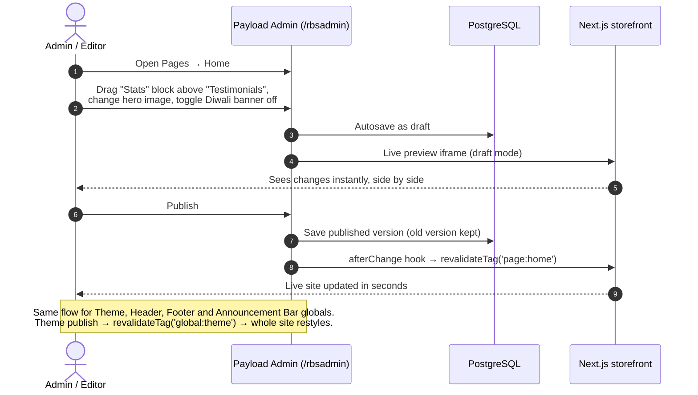

**What each role can do**

| Action | Owner | Editor | Order manager |
|---|:-:|:-:|:-:|
| Theme, globals, pages, blocks | ✅ | ✅ | ❌ |
| Products, categories, hampers | ✅ | ✅ | view |
| Orders, refunds, enquiries | ✅ | ❌ | ✅ |
| Coupons, delivery zones, site settings | ✅ | ❌ | ❌ |
| Manage admin users | ✅ | ❌ | ❌ |

---

## 9. Authentication

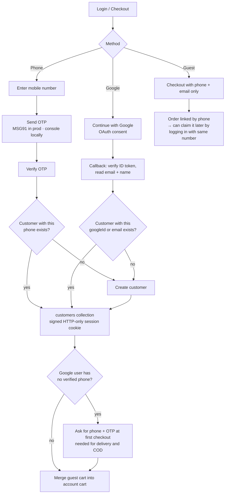

From **Account → Login methods**, a shopper can link the other method, so phone and Google both sign in to the same account.

**Running locally:** Google sign-in needs a free OAuth client from Google Cloud Console with redirect URI `http://localhost:3000/api/auth/google/callback`. Until those keys are in `.env`, the Google button is hidden and phone OTP still works.

---

## 10. Build-Your-Own Box

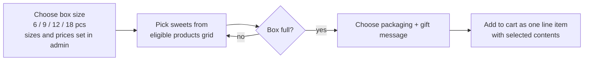

---

### How these flows map to milestones

| Flow | Milestone (see PLAN.md §13) |
|---|---|
| 7, 8 | Phase 1 – Customization core |
| 1, 2 | Phase 2–3 – Blocks and catalog |
| 3, 4 | Phase 4 – Cart and checkout |
| 5, 9 | Phase 5 – Accounts and orders |
| 6, 10 | Phase 6 – Gifting and B2B |
